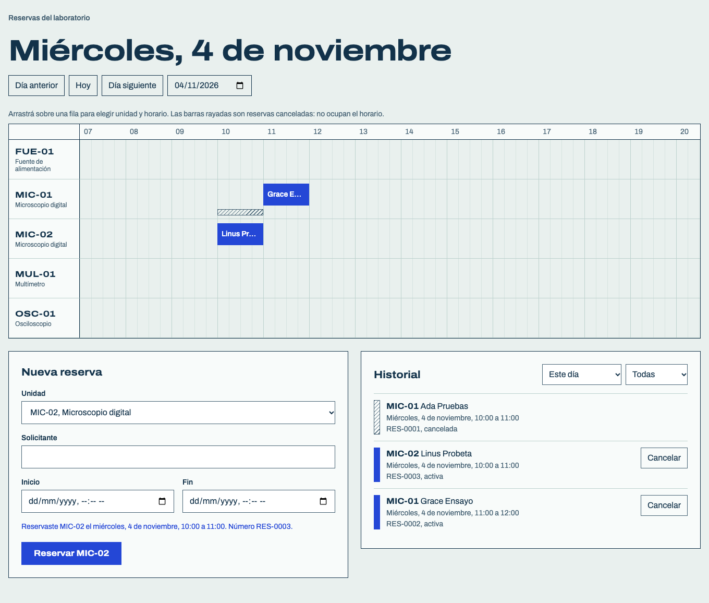

# Reservas del laboratorio

Sistema local para consultar disponibilidad, reservar y cancelar unidades de un laboratorio sin perder el historial. Se construyó con un agente de programación para el Challenge IA de Tópicos Avanzados de Ingeniería del Software.



**Inicio rápido.** Requiere Node 22.13 o superior y pnpm 12. No hace falta ninguna cuenta ni credencial.

```bash
pnpm install
pnpm test
pnpm dev     # http://localhost:5173
```

## 1. Especificación

La coordinación de un laboratorio registra pedidos en mensajes y una planilla. A veces confirma la misma unidad para horarios superpuestos, y otras veces una cancelación sigue bloqueando el horario.

**Alcance:** leer el inventario de 5 unidades, consultar disponibilidad, crear y cancelar reservas, y conservar todo entre reinicios. Quedan fuera la administración del inventario, la autenticación, las notificaciones y el despliegue.

**Reglas principales**
- Una reserva activa ocupa su intervalo; una cancelada no bloquea y conserva sus datos.
- Unidad conocida, solicitante no vacío, fechas reales e inicio estrictamente anterior al fin.
- Se rechazan superposiciones de reservas activas de la misma unidad.
- Se permiten límites consecutivos y reservas simultáneas de unidades distintas.
- Disponibilidad y creación aplican las mismas reglas.

**Supuestos:** zona `America/Argentina/Buenos_Aires`, formato `YYYY-MM-DDTHH:MM`, sin reservas con inicio pasado, sin límites de duración ni de anticipación.

La versión completa, con requisitos, reglas, 9 supuestos y 14 criterios de aceptación, está en [`docs/especificacion.md`](docs/especificacion.md). La versión inicial se commiteó antes que el código, en [`33b3819`](https://github.com/Frandols/challenge-agents-reservas/commit/33b3819).

## 2. Solución

### Estructura

Monorepo con Turborepo y pnpm.

```
apps/
├── api/                  Express, TypeScript, SQLite y Drizzle
│   ├── data/units.json   inventario inicial
│   ├── drizzle/          migraciones
│   └── src/              routes, controllers, services, models, validators, middlewares, db
└── web/                  React y Vite
    └── src/
        ├── App.tsx       compone las features
        ├── features/     day-board, reservation-booking, reservation-history
        └── shared/       cliente HTTP, tiempo y estilos
docs/                     especificación, decisiones, episodios y verificación
```

### Decisiones técnicas

- **SQLite en un archivo:** no necesita servidor ni cuentas, así que la app se reproduce con `pnpm install`.
- **Una sola regla de superposición:** `findActiveOverlapping` en `apps/api/src/models/reservations.ts`. La usan disponibilidad y creación.
- **Transacción `IMMEDIATE`:** la creación verifica e inserta sin que otra conexión escriba en el medio.
- **Reloj inyectado:** las pruebas no dependen de la fecha real.

El detalle y las alternativas están en [`docs/decisiones.md`](docs/decisiones.md).

### Requisitos previos

| Herramienta | Versión | Notas |
|---|---|---|
| Node.js | 22.13 o superior | Probado con 22.13.1. Ver `.nvmrc` |
| pnpm | 12.14.0 | Fijado en `package.json`. Se puede activar con `corepack enable` |

Las dependencias quedan fijadas en `pnpm-lock.yaml`.

### Comandos

| Comando | Qué hace |
|---|---|
| `pnpm install` | Instala las dependencias |
| `pnpm dev` | Levanta API (puerto 3001) y web (puerto 5173) |
| `pnpm --filter @reservas/api start` | Levanta solo la API |
| `pnpm test` | Ejecuta todas las pruebas |
| `pnpm lint`, `pnpm typecheck`, `pnpm build` | Controles estáticos y compilación |
| `pnpm db:reset --yes` | **Borra todas las reservas** |

### Datos

- **Dónde persisten:** `apps/api/data/reservas.db`, que no se versiona. Se puede cambiar con la variable `DATABASE_PATH`.
- **Carga inicial:** es automática. Al iniciar, la API aplica las migraciones y carga `apps/api/data/units.json` sin tocar las reservas.
- **Reinicio de datos:** `pnpm db:reset --yes` **borra todas las reservas, activas y canceladas**, y vuelve la numeración a `RES-0001`. Conserva el inventario. Sin `--yes` solo muestra una advertencia.

### Ejemplo de entrada y salida

```bash
curl -X POST localhost:3001/api/reservations \
  -H 'Content-Type: application/json' \
  -d '{"unitId":"MIC-01","requester":"Ada Pruebas","start":"2099-01-10T10:00","end":"2099-01-10T11:00"}'
```

```json
{"id":"RES-0001","unitId":"MIC-01","requester":"Ada Pruebas","startsAt":"2099-01-10T10:00","endsAt":"2099-01-10T11:00","status":"active","createdAt":"2026-11-02T12:28","cancelledAt":null}
```

Una reserva superpuesta responde `409` con el código `reservation_conflict` y las reservas en conflicto.

| Método y ruta | Uso |
|---|---|
| `GET /api/units` | Inventario |
| `GET /api/availability?unitId&start&end` | Disponibilidad y conflictos |
| `GET /api/reservations?unitId&date&status` | Reservas, incluidas las canceladas |
| `POST /api/reservations` | Crear una reserva |
| `POST /api/reservations/:id/cancel` | Cancelar una reserva |

### Verificación

Los criterios CA-1 a CA-13 se prueban en `apps/api/src/reservations.test.ts`. CA-14 se prueba en `apps/api/src/persistence.test.ts` y con un procedimiento manual que detiene el proceso real con SIGTERM y SIGKILL.

Comandos, versiones y resultados observados, incluidos los fallos, están en [`docs/verificacion.md`](docs/verificacion.md).

### Pendientes y limitaciones

- Sin autenticación: cualquiera con acceso local puede reservar o cancelar, porque está fuera de alcance.
- La concurrencia real entre procesos no se probó, y tampoco `pnpm db:reset` con la API en ejecución.
- La detención del proceso real y la confirmación `--yes` solo se comprueban de forma manual.
- `better-sqlite3` está fijado en 12.11.1 porque la 13.0.3 falló en Node 22.13.1 sobre darwin-arm64. La causa no se investigó.
- Con la API caída, el mismo mensaje se repite en los tres paneles.
- Los nombres largos se cortan en las reservas breves del tablero. El nombre completo está en el tooltip y en el historial.
- En móvil el tablero es una lista de solo lectura y se reserva con el formulario.
- La interfaz solo se recorrió en Chromium headless. Falta probar otros navegadores y lectores de pantalla.

## 3. Preparación del agente

Se usó **Claude Code 2.1.316** con el modelo **Opus 5.5** (`claude-opus-5-5`).

| Tema | Evidencia |
|---|---|
| Entorno, modelo, contexto y permisos | [`docs/preparacion-agente.md`](docs/preparacion-agente.md) |
| Instrucciones | [`CLAUDE.md`](CLAUDE.md) |
| Configuración de permisos | [`.claude/settings.json`](.claude/settings.json) |
| Progreso | [`docs/progreso.md`](docs/progreso.md) |

**Adaptación específica:** `CLAUDE.md` exige una prueba de turnos consecutivos, en rojo y en un commit anterior, antes de tocar la lógica de superposición. Se comprueba en el historial: la prueba en [`e41d6c5`](https://github.com/Frandols/challenge-agents-reservas/commit/e41d6c5) precede a la implementación en [`1bb21ed`](https://github.com/Frandols/challenge-agents-reservas/commit/1bb21ed).

## 4. Registro de decisiones y delegación

Las decisiones significativas, con motivos, alternativas y consecuencias, están en [`docs/decisiones.md`](docs/decisiones.md). Las más importantes:

- **D-1:** el stack cambió dos veces y terminó en SQLite para que la app se reproduzca sin cuentas.
- **D-8:** el autor descartó lanzar procesos en la prueba automática de persistencia, y el agente desaconsejó los mocks.
- **D-9:** el tablero muestra el conflicto que informa la API para no duplicar la regla.

Los tres episodios de delegación están completos en [`docs/episodios.md`](docs/episodios.md):

| Episodio | Requisito | Decisión humana | Evidencia |
|---|---|---|---|
| [1. Reglas de dominio](docs/episodios.md#episodio-1-reglas-de-dominio) | RF-2 a RF-5, RN-1 a RN-8 | Aceptar | [`1bb21ed`](https://github.com/Frandols/challenge-agents-reservas/commit/1bb21ed) |
| [2. Persistencia](docs/episodios.md#episodio-2-persistencia) | RF-6, CA-14 | Corregir | [`69ad970`](https://github.com/Frandols/challenge-agents-reservas/commit/69ad970) |
| [3. Interfaz](docs/episodios.md#episodio-3-interfaz) | RF-1 a RF-5 | Aceptar | [`7a8b33e`](https://github.com/Frandols/challenge-agents-reservas/commit/7a8b33e) |
